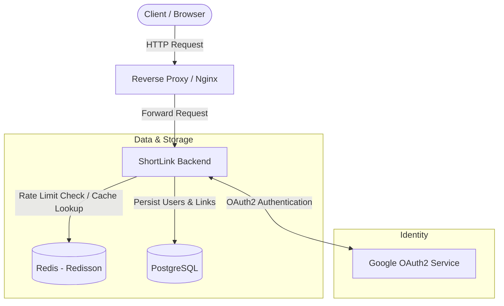
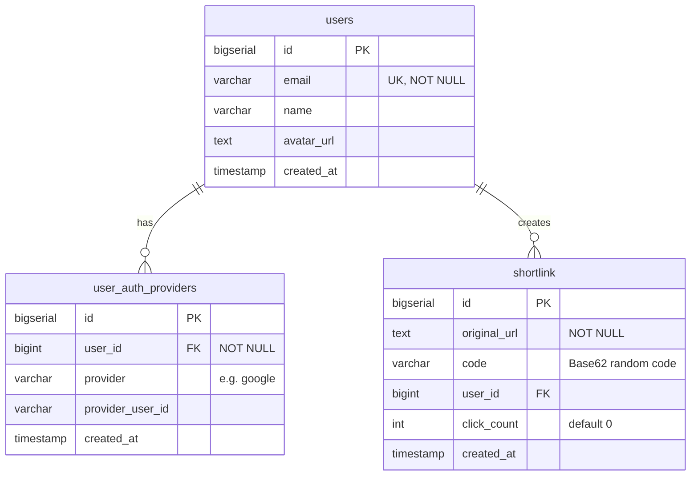

# 🔗 ShortLink - URL Shortener Backend Service

A URL shortening backend service built with **Spring Boot 4 / Java 17**, leveraging **Redis (Redisson)** for caching and distributed rate limiting, **PostgreSQL** with **Liquibase** for persistent storage and database migrations, and **Google OAuth2 / JWT** for authentication.

---

## 📑 Table of Contents

- [Overview](#1-overview)
- [Features](#2-features)
- [Tech Stack](#3-tech-stack)
- [System Architecture](#4-system-architecture)
- [Database Design](#5-database-design)
- [Project Structure](#6-project-structure)
- [Getting Started](#7-getting-started)
- [API Reference](#8-api-reference)
- [Security & Rate Limiting](#9-security--rate-limiting)
- [Testing](#10-testing)

---

## 1. Overview

**ShortLink** provides a URL shortening solution designed to handle frequent redirection requests while managing resource usage and user authentication.

Key characteristics include:

- Generating compact, randomized Base62 short codes.
- Redis-based caching for low-latency URL redirection.
- Per-user rate limiting using the Token Bucket algorithm.
- Cookie-based authentication with Google OAuth2 and JWT.
- Persistent storage and database schema management using PostgreSQL and Liquibase.

---

## 2. Features

- **Randomized Base62 Short Links:** Generates random alphanumeric short codes (5–10 characters) for submitted URLs.
- **Redis Caching:** Caches `code -> original_url` mappings using Redisson `RMap` to reduce repetitive database queries during redirection.
- **Visit Tracking:** Tracks the number of visits for each shortened URL through the `click_count` field.
- **Distributed Rate Limiting:** Limits shortlink creation requests per user using the Token Bucket algorithm (capacity: 100 tokens, refill rate: 1 token every 3 seconds).
- **Authentication & Authorization:**
  - Google OAuth2 sign-in.
  - Stateless JWT authentication using `HttpOnly` and `Secure` cookies.
- **Paginated History:** Allows authenticated users to retrieve their shortened URLs with sorting and pagination support through Spring Data `Pageable`.
- **Database Migrations:** Manages database schema changes using Liquibase.
- **Containerization:** Provides a multi-stage Docker build and Docker Compose configuration for deployment.

---

## 3. Tech Stack

| Category | Technology | Details |
| :--- | :--- | :--- |
| **Language** | Java | 17 |
| **Framework** | Spring Boot | 4.0.3 |
| **Security** | Spring Security, Spring OAuth2 Client, JJWT | 0.13.0 |
| **Database** | PostgreSQL | 14+ |
| **ORM & Persistence** | Spring Data JPA, Hibernate | - |
| **Database Migration** | Liquibase | Master Changelog YAML |
| **Caching & Rate Limiting** | Redis, Redisson | 4.3.0 |
| **Mapping & Helpers** | Lombok, MapStruct | 1.18.44 / 1.5.5 |
| **Containerization** | Docker, Docker Compose | Eclipse Temurin 17 JRE Alpine |
| **Testing** | JUnit 5, Mockito | - |

---

## 4. System Architecture



---

## 5. Database Design

Database schema migrations are managed using **Liquibase**.



---

## 6. Project Structure

```text
shortlink/
├── .github/                       # CI/CD pipelines
├── src/
│   ├── main/
│   │   ├── java/com/example/shortlink/
│   │   │   ├── auth/              # OAuth2 authentication, JWT filter & handlers
│   │   │   ├── common/            # Custom exceptions & GlobalExceptionHandler
│   │   │   ├── infrastructure/    # SecurityConfig, CORS, RedissonConfig
│   │   │   ├── shared/            # Common constants, error codes, DTOs & utilities
│   │   │   ├── shortlink/         # Controller, Service, Entity, Repository
│   │   │   ├── user/              # User domain: Service, Controller, Entity, Repository
│   │   │   ├── user_auth_provider/# OAuth2 provider mapping
│   │   │   └── ShortlinkApplication.java
│   │   └── resources/
│   │       ├── db/changelog/      # Liquibase migrations
│   │       └── application.yaml   # Main application configuration
│   └── test/                      # Unit & integration tests
├── Dockerfile                     # Multi-stage Dockerfile
├── docker-compose.yaml            # Docker Compose configuration
├── pom.xml                        # Project dependencies
└── README.md                      # Project documentation
```

---

## 7. Getting Started

### Prerequisites

- **JDK:** Version 17+
- **Build Tool:** Maven 3.8+ (or use the included Maven Wrapper)
- **Database:** PostgreSQL 14+
- **Cache:** Redis 6+
- **Docker & Docker Compose:** Optional, for containerized deployment.

### Configuration

Configure the following properties through your application profile (e.g., `application-secret.properties`) or environment variables.

| Parameter / Variable | Description | Example |
| :--- | :--- | :--- |
| `mydb.url` | PostgreSQL JDBC connection URL | `jdbc:postgresql://localhost:5432/shortlink_db` |
| `mydb.username` | Database username | `postgres` |
| `mydb.password` | Database password | `********` |
| `redis.host` | Redis host address | `redis://localhost:6379` |
| `redis.password` | Redis password (if enabled) | `********` |
| `shortlink.google.client-id` | Google OAuth2 Client ID | `<client-id>.apps.googleusercontent.com` |
| `shortlink.google.client-secret` | Google OAuth2 Client Secret | `<client-secret>` |
| `shortlink.jwt.secret` | JWT signing secret | `<strong-jwt-secret-key>` |
| `PORT` | Application server port (optional) | `10082` |

**Note:** Never commit actual credentials or secret keys to version control.

### Run Locally

**1. Start PostgreSQL and Redis**

You can use Docker to start the required dependencies:

```bash
docker run -d --name redis -p 6379:6379 redis:alpine

docker run -d --name postgres \
  -p 5432:5432 \
  -e POSTGRES_DB=shortlink_db \
  -e POSTGRES_PASSWORD=postgres \
  postgres:alpine
```

**2. Build and start the application**

Linux / macOS:

```bash
./mvnw clean compile
./mvnw spring-boot:run
```

Windows:

```cmd
mvnw.cmd clean compile
mvnw.cmd spring-boot:run
```

The server will be available at:

```text
http://localhost:10082
```

### Run with Docker

**1. Build the Docker image**

```bash
docker build -t shortlink-be:latest .
```

**2. Start the application stack**

```bash
docker compose up -d
```

---

## 8. API Reference

### Authentication

| Method | Endpoint | Access | Description |
| :--- | :--- | :--- | :--- |
| `GET` | `/oauth2/authorization/google` | Public | Initiates Google OAuth2 authentication flow |
| `GET` | `/login/oauth2/code/google` | Public | Google OAuth2 callback endpoint |
| `POST` | `/api/logout` | Authenticated | Clears the JWT cookie and logs out the user |

### Shortlink Management

#### 1. Shorten a URL

- **Endpoint:** `POST /api/shortlink/shorten`
- **Access:** Authenticated
- **Headers:** `Content-Type: application/json`

Request Body:

```json
{
  "originalUrl": "https://example.com/very/long/destination/url"
}
```

Response (200 OK):

```json
{
  "isSuccess": true,
  "data": "https://<your-domain>/s/aB12Xy"
}
```

#### 2. Redirection

- **Endpoint:** `GET /s/{code}`
- **Access:** Public
- **Description:** Returns an HTTP 302 redirect to the original URL. Redis is used to retrieve cached URL mappings and reduce database lookups.

#### 3. History

- **Endpoint:** `GET /api/shortlink/history?page=0&size=10&sort=createdAt,desc`
- **Access:** Authenticated

Response (200 OK):

```json
{
  "content": [
    {
      "id": 1,
      "originalUrl": "https://example.com/very/long/destination/url",
      "code": "aB12Xy",
      "clickCount": 42,
      "createdAt": "2026-03-31T15:30:00Z"
    }
  ],
  "page": 0,
  "size": 10,
  "totalElements": 1,
  "totalPages": 1
}
```

### User Profile

#### Get Current User Info

- **Endpoint:** `GET /api/user/me`
- **Access:** Authenticated

Response (200 OK):

```json
{
  "id": 1,
  "email": "user@example.com",
  "name": "User Name",
  "avatarUrl": "https://example.com/avatar.png"
}
```

---

## 9. Security & Rate Limiting

- **Token Bucket Rate Limiting:**
  - Implemented using Redis (`RMap<Long, RequestToken>`) with user IDs as keys.
  - Bucket capacity: **100 tokens**.
  - Refill rate: **1 token every 3 seconds**.
  - Requests exceeding the limit receive HTTP 429 (`OUT_OF_TOKEN_REQUEST`).
- **JWT Cookie Protection:**
  - JWTs are stored in `HttpOnly` and `Secure` cookies.
  - Cookie configuration includes `SameSite=None`.
- **CORS & Reverse Proxy Support:**
  - Whitelist-based CORS configuration with credential support.
  - Forwarded header handling for `X-Forwarded-For` and `X-Forwarded-Proto`.

---

## 10. Testing

The project includes unit tests using **JUnit 5** and **Mockito**.

Test coverage includes:

- ShortLink service logic.
- Short code generation.
- Rate limiting behavior.
- Redis cache interactions.

Run tests locally:

Linux / macOS:

```bash
./mvnw test
```

Windows:

```cmd
mvnw.cmd test
```

